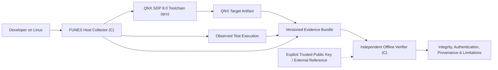
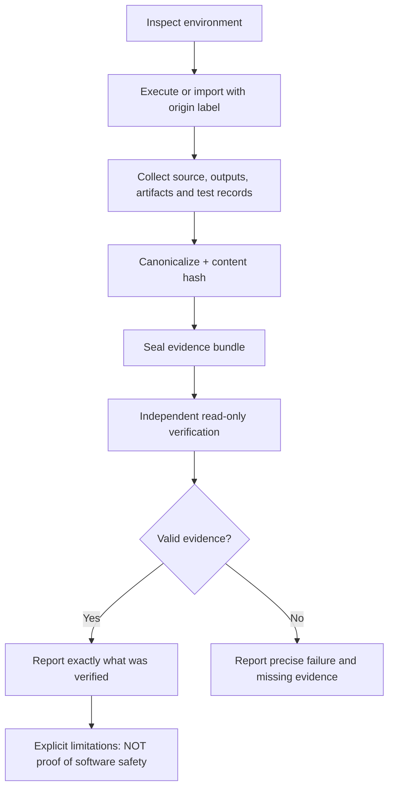
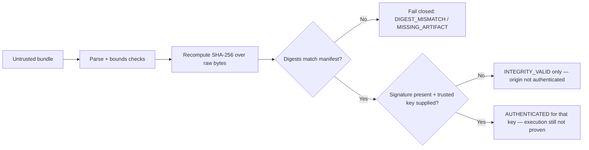

English · [Español](README_ES.md) · [Showcase](showcase/index.html) · [Technical README](docs/architecture/ARCHITECTURE.md)

# FUNES THE MEMORIOUS

> **Your software passed the tests. Can you prove it?**
>
> Every build has a history. Every test leaves evidence. Make both verifiable.

**Funes the Memorious is a Linux-hosted provenance tool for QNX 8.0 development, written in C, that records what was actually built and tested and lets an independent reviewer verify that record offline.**

Repository: `annatchijova/funes-the-memorious`. License: MIT (see [LICENSE](LICENSE)).

The name comes from Borges' character who forgets nothing. This tool tries to do the opposite of vague recollection: it remembers exactly what was collected, shows where each record came from, and states plainly where certainty stops. It is not a memory of success. It is evidence that can be challenged.

---

## The problem

In embedded and real-time work, "it passed" is usually a claim, not evidence. A reviewer who was not present during the build is typically handed a binary, a log excerpt, and a summary. None of those answer the basic questions:

- Which source state produced this binary?
- Which toolchain and target were selected?
- Which commands actually ran, and what did they output?
- Which tests ran, against which artifact, with which result?
- Has any artifact, log, or report changed since it was recorded?

When those questions cannot be answered from artifacts alone, trust depends on trusting the producer. For QNX systems — where a wrong binary or an untested change can have safety consequences — that dependency is the problem this project addresses.

## What this is

Funes is a pair of programs with a deliberately narrow contract:

1. **A host collector** (`funes`) runs on Linux. It executes build and test commands under observation, records exit statuses and bounded output, hashes source and output artifacts, and seals the result into a versioned evidence bundle.
2. **An independent verifier** (`funes-verify`) runs offline, read-only, with no dependency on the collector's internal logic. It re-checks the bundle's structure and hashes and reports exactly what holds and what does not.

Between them sits a public bundle format that another engineer can implement a checker for without using Funes at all. The format — not the collector — is the shared contract.

A useful way to picture it: the collector is a witness that writes down what it saw; the verifier is a second reader who checks that the notes are internally consistent and untampered. Neither one certifies that the software is safe. They certify, within stated limits, what evidence exists and whether it still matches.

## What you can observe

The reviewer workflow is observable end to end on a Linux host:

```text
$ funes doctor                       # inspect host + QNX toolchain
$ funes capture --out BUNDLE --source SRC --artifact OUT:target-executable -- BUILD_CMD...
$ funes add-test --bundle BUNDLE --artifact-sha256 HEX -- TEST_CMD...
$ funes-verify BUNDLE                # independent offline check
$ funes keygen --out seed.txt --pub-out pub.txt   # once; seed stays private
$ funes sign --bundle BUNDLE --key seed.txt
$ funes-verify --trusted-key pub.txt BUNDLE        # authenticated only under your key
$ funes-verify --json BUNDLE
```

(`capture` and `add-test` seal the bundle as their final step; there is no
separate seal command.) A successful run ends with a bundle directory.
Changing one byte in a recorded artifact and re-running `funes-verify` ends
with exit 3 and a diagnostic naming the exact artifact and digest that
diverged. That mutation exercise — not a green checkmark — is the core
property to inspect.

**Current status:** Levels 0, 1, 3, 5, and 6 are implemented and tested on
the Linux host (`VERIFIED_HOST_ONLY`, 126-check suite; see
[docs/STATUS.md](docs/STATUS.md)). QNX integration (Level 2) is `BLOCKED`:
no QNX SDP is installed on the development host, and no QNX result is claimed.

### How this differs from the typical approach

| Property | Typical "passed" handoff | Funes evidence bundle |
|---|---|---|
| Source identity | A commit hash quoted in text | Commit plus dirty state plus content digest of an explicit source set |
| Build record | A copied log excerpt | Observed command vector, exit status, bounded stdout/stderr, timestamps |
| Test record | A summary count ("42 passed") | Observed run linked to a specific artifact digest; imported reports stay labeled `IMPORTED` |
| Integrity check | Re-running the same tool | Independent verifier recomputes hashes from raw bytes, offline |
| Tamper signal | None, or a checksum the producer also controls | Digest mismatch with artifact-specific diagnostic and non-zero exit |
| Overclaim guard | "Verified" as a single verdict | Separate fields for integrity, signature, trust, and observation status |

Each row states a concrete property of the design. Whether the implementation delivers it is tracked level by level in [docs/ROADMAP.md](docs/ROADMAP.md), not asserted here ahead of evidence.

## How it works (high level)



The collector supervises subprocesses on the Linux host; it never assumes a Linux binary is a QNX binary. When the QNX SDP is present, the collector invokes the installed `qcc` and records its identity, configuration, and target. When the SDP is absent, the collector says so and records host-only evidence under an honest label.





Deep design — canonical serialization, hashing rules, trust boundaries, threat model — lives in the [Technical README](docs/architecture/ARCHITECTURE.md) and the specs under `docs/`. This page routes you there instead of repeating it.

## What exists today

**Capability → evidence → interpretation, kept separate:**

| Capability claimed | Evidence in this commit | What it licenses you to conclude |
|---|---|---|
| Repository foundations | This README, [docs/ROADMAP.md](docs/ROADMAP.md), [docs/engineering/SKILLS-APPLIED.md](docs/engineering/SKILLS-APPLIED.md), `.gitignore`, `LICENSE` | The project's scope, invariants, and level plan are written down and reviewable. |
| Language decision | Owner directive: C, recorded with alternatives and revisit triggers in [docs/architecture/ADR-001-LANGUAGE-AND-TARGETS.md](docs/architecture/ADR-001-LANGUAGE-AND-TARGETS.md) | The stack is chosen and the bundle format is language-neutral, so the decision stays reversible. |
| Collector / verifier / bundle | `make` builds `bin/funes` and `bin/funes-verify` in C; `make test` runs the 126-check host suite; [docs/STATUS.md](docs/STATUS.md) records observed outcomes | Host build/test capture, sealing, tamper detection, signing/trust reporting, test evidence, and independent verification work on Linux. Nothing about QNX execution follows from this. |
| QNX integration | Fixture source and setup procedure exist ([docs/QNX-SETUP.md](docs/QNX-SETUP.md)); `funes doctor` reports `NOT_FOUND` on this host | No QNX execution claim can be made. Status: `BLOCKED` / `NOT_RUN`. |

Live status is maintained in [docs/ROADMAP.md](docs/ROADMAP.md) and, from Level 1 onward, in `docs/STATUS.md` generated from real runs. This README will be updated in the same commit as any status change, never ahead of it.

## Roadmap at a glance

Full entry/exit criteria, deliverables, threats, and tests per level: [docs/ROADMAP.md](docs/ROADMAP.md).

| Level | Name | Status |
|---|---|---|
| 0 | Foundations and invariants | DONE |
| 1 | Real host capture and independent verification | DONE (`VERIFIED_HOST_ONLY`) |
| 2 | Genuine QNX SDP 8.0 build integration | BLOCKED — QNX SDP 8.0 not installed on the dev host |
| 3 | Authenticated provenance and trust policies | DONE (`VERIFIED_HOST_ONLY`) |
| 4 | Test evidence and QNX runtime | PARTIAL (host slice DONE, `VERIFIED_HOST_ONLY`; QEMU/QNX runtime `NOT_RUN`) |
| 5 | Forensic Comparison and Audit UX | DONE (`VERIFIED_HOST_ONLY`) |
| 6 | Security, performance, portability and release | DONE (`VERIFIED_HOST_ONLY`) |

A level is `DONE` only when its exit criteria are met and linked to observed commands or artifacts. A README subsection existing is not evidence.

## Invariants and prohibited overclaims

These invariants govern every later level. They are design constraints, not results:

1. Evidence integrity is not evidence authenticity, is not source truth, is not software safety.
2. Recording a claimed test result is not observing a test run.
3. A signature proves control of a signing key, not that an execution occurred.
4. A checksum match proves consistency against a reference, not correctness of the reference.
5. A verified bundle does not imply a verified environment or a reproducible build.
6. No generated or fake QNX evidence may be labeled as real QNX execution.
7. Uncertain, absent, incomplete, conflicting, and unverified evidence must be distinguishable.
8. Basic offline verification requires no network calls or external services.
9. The verifier must not import the collector's internal business logic.
10. Missing verification must never be silently downgraded into success.
11. The word is "tamper-evident", never "tamper-proof", with trust assumptions stated.
12. No AI-generated verdict determines cryptographic or evidentiary validity.

| Claim | Allowed wording | Prohibited overclaim |
|---|---|---|
| Digests match | `INTEGRITY_VALID` for these bytes against this manifest | "The software is safe / trusted / correct" |
| Signature valid under a supplied key | `AUTHENTICATED` for that key | "The tests really ran" |
| Test run observed by collector | `OBSERVED` with command, exit status, artifact digest | "Coverage is complete" from an exit code alone |
| Imported test report | `IMPORTED/UNVERIFIED_ORIGIN` | Promoting it to observed execution |
| QNX artifact present | Only with real `qcc` evidence and target proof | Labeling a Linux binary as a QNX target binary |

## Requirements

- **Development host:** Linux (owner develops on Linux Mint). The collector and verifier are C programs built with a host C compiler (`gcc` or `clang`) and `make`.
- **Language:** C (C11 or later). Both binaries are C so the verifier can be small, auditable, and free of a language runtime dependency. The QNX demonstration fixture is also C, compiled with the QNX toolchain when available.
- **QNX (for QNX-specific levels):** QNX SDP 8.0 installed and licensed by the user, with `QNX_HOST` / `QNX_TARGET` configured. Funes never installs the SDP, accepts its license, or redistributes its content. See [docs/QNX-SETUP.md](docs/QNX-SETUP.md).
- **Optional:** QEMU for QNX runtime evidence (Level 4), only when genuinely available.

Cryptography, when it lands in Level 3, will use established primitives (SHA-256; Ed25519 if signing is implemented) from maintained libraries or the platform — never custom algorithms.

## Try it

Executed as written on the development host (`VERIFIED_HOST_ONLY`):

```bash
git clone https://github.com/annatchijova/funes-the-memorious.git
cd funes-the-memorious
make
make test
./bin/funes doctor
```

Observed outcomes are recorded in [docs/STATUS.md](docs/STATUS.md).

### Host-only vs. QNX evidence

Every example, test, and status table in this project distinguishes:

- `VERIFIED_REAL_QNX` — exercised with QNX SDP 8.0 with target-specific proof.
- `VERIFIED_HOST_ONLY` — genuinely tested on the Linux host, no QNX SDK run.
- `CONTRACT_TEST_ONLY` — adapter logic tested without the proprietary SDK.
- `NOT_RUN` — not executed.
- `FAILED` — attempted, failed, artifacts and reason preserved.

Synthetic material, if ever needed for illustration, lives under `examples/synthetic/` with an explicit **SYNTHETIC — NOT QNX EVIDENCE** banner. No synthetic transcript is ever presented as a real run.

## QNX 8.0 integration

Funes is a host tool: it runs on Linux and drives the QNX toolchain installed on that host. It does not run inside QNX, and no part of the host binaries is claimed to execute on a QNX target.

Planned integration (Levels 2 and 4):

- SDK discovery through `QNX_HOST` / `QNX_TARGET` and the SDP environment scripts, validated by executing the toolchain — a file merely named `qcc` is not accepted as authentic.
- `qcc` / `q++` identity, version output, and supported-target listing captured with timeouts and bounded output.
- Build invocation with an explicit target and a preserved argument vector (no shell string concatenation by default).
- A small original C fixture under `examples/qnx8-hello/` (`main.c`, `Makefile`, `README.md`) as the artifact under investigation, with a deliberately failing variation so failure evidence can be demonstrated.
- Optional QEMU runtime capture when a QNX image and QEMU are genuinely available.

The host in which this repository was founded has no QNX SDP installed (`qcc` absent, `QNX_HOST`/`QNX_TARGET` unset). Level 2 is therefore `BLOCKED`, not simulated. Official references:

- [QNX Everywhere — get started](https://qnx.software/en/developers/get-started/qnx-everywhere)
- [QNX SDP 8.0 documentation](https://www.qnx.com/developers/docs/8.0/index.html)
- [QNX SDP quickstart](https://www.qnx.com/developers/docs/8.0/com.qnx.doc.qnxsdp.quickstart/topic/about.html)
- [Installing the SDP on a Linux host](https://www.qnx.com/developers/docs/8.0/com.qnx.doc.qnxsdp.quickstart/topic/install_host.html)
- [qcc reference](https://qnx.com/developers/docs/8.0/com.qnx.doc.neutrino.utilities/topic/q/qcc.html)

If the SDP does not support the owner's Linux Mint host directly, the documented path is an isolated supported Ubuntu VM for SDK work. Funes documentation will state the supported-host facts from QNX release notes rather than pretend Mint is supported.

## Verification semantics (summary)

The verifier fails closed. Distinct outcomes are never collapsed into one score:

- `capture_status`, `integrity_status`, `signature_status`, `signer_trust_status`, `qnx_toolchain_status`, `test_observation_status`, `artifact_status`, `limitations`.

Implemented v1 error categories: `BUNDLE_INVALID` (2), `DIGEST_MISMATCH` (3), `MISSING_ARTIFACT` (4), `UNSUPPORTED_SCHEMA` (5), `RESOURCE_LIMIT_EXCEEDED` (6), and `SEAL_MISMATCH` (7); exit 0 is `INTEGRITY_VALID` and exit 1 is reserved for tool errors. Signature-related categories (`SIGNATURE_INVALID`, `SIGNER_UNTRUSTED`) arrive with Level 3. Exact names, exit codes, and JSON diagnostics are specified in [docs/spec/VERIFIER-SEMANTICS.md](docs/spec/VERIFIER-SEMANTICS.md) and implemented by the independent verifier. Full semantics: [Technical README](docs/architecture/ARCHITECTURE.md).

Security model, assets, adversaries, and trust boundaries are specified in [docs/security/THREAT-MODEL.md](docs/security/THREAT-MODEL.md). In short: hashes alone give integrity against a supplied manifest, not authenticated origin; signatures, when implemented, require an explicitly trusted public key supplied by the verifier; and a software-only collector on an untrusted host cannot prove the host was honest.

## Repository layout

```text
funes-the-memorious/
├── README.md                  # this file — primary, human-facing
├── README_ES.md               # Spanish adaptation
├── LICENSE                    # MIT
├── docs/
│   ├── ROADMAP.md             # level plan with entry/exit criteria and live status
│   ├── architecture/          # ADRs and the Technical README (ARCHITECTURE.md)
│   ├── spec/                  # evidence bundle and verifier semantics specs
│   ├── security/              # threat model
│   └── engineering/           # skills applied and setup guides
├── src/                       # collector (funes) and its SHA-256
├── verifier/                  # independent verifier (funes-verify), own SHA-256/parser
├── tests/                     # host unit/integration/adversarial suite
├── examples/
│   ├── host-hello/            # host fixture for Level 1 exercises
│   └── qnx8-hello/            # original C fixture for QNX builds (Level 2)
├── .github/workflows/         # host-only CI
├── Makefile
└── bin/                       # built binaries (gitignored)
```

## Development

```bash
make            # build bin/funes and bin/funes-verify (-Wall -Wextra -Werror)
make test       # 126-check host suite: integration + adversarial cases
make clean
```

Tests are falsifiable: failing builds, failing tests, missing evidence, tampered artifacts and logs, seal/schema failures, symlink escapes, unexpected material, truncation, secret-leak and determinism checks are first-class cases, and a test that has never been seen red does not count as evidence. CI (`.github/workflows/ci.yml`) runs host-only; QNX steps run only where the SDP is legally available. Fuzzing is Level 6.

## Limitations and verified-environment matrix

Scoped to what is true today:

| Capability | Expected observation | State |
|---|---|---|
| Linux host collector | Real command captured with exit status and output | DONE (`VERIFIED_HOST_ONLY`) |
| Build artifact digest | SHA-256 over actual artifact bytes | DONE (`VERIFIED_HOST_ONLY`) |
| Independent verifier | Separate C binary, no collector internal imports | DONE (`VERIFIED_HOST_ONLY`) |
| Artifact / log mutation | Non-zero verification failure with specific diagnostic | DONE (`VERIFIED_HOST_ONLY`) |
| Missing evidence | Exact diagnostic, fail closed | DONE (`VERIFIED_HOST_ONLY`) |
| Unknown signer | Reported untrusted, never authenticated | DONE (`VERIFIED_HOST_ONLY`): exits 8/9, `SIGNER_UNTRUSTED` |
| QNX `qcc` detection | Real tool and environment output | BLOCKED — SDP absent |
| QNX 8 target compilation | Real `qcc` log and target binary | BLOCKED — SDP absent |
| QNX QEMU runtime | Real target execution output | NOT_RUN |

What successful verification will **not** mean, at any level: that the software is safe, that the original host was honest, that tests were adequate, or that a build is reproducible. Those boundaries are part of the design, stated here by narrowing the claims above — the exhaustive account lives in the threat model.

## License

MIT. See [LICENSE](LICENSE). No QNX binaries, SDK content, installation media, product keys, or proprietary samples are included in this repository, and none may be committed.
